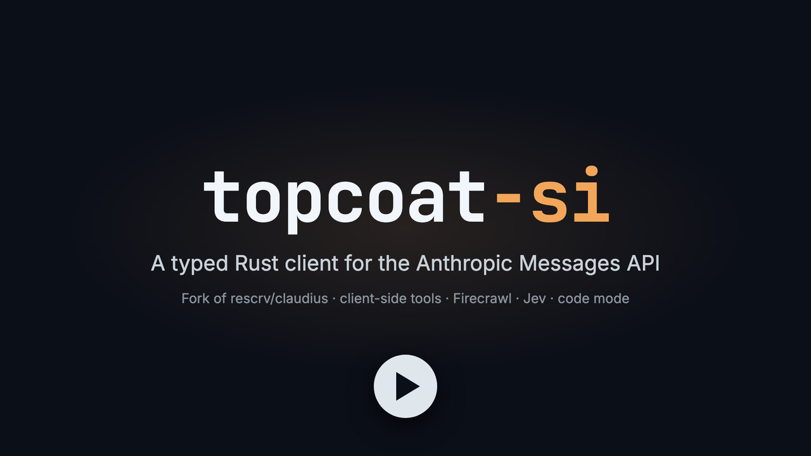

# Topcoat SI

Topcoat SI is a typed Rust client for the Anthropic Messages API. It also ships client-side tools that let Claude search the web, read pages, ask for typed judgments and run Python. It is built for Topcoat apps and works in any async Rust program on Tokio.

[](https://github.com/matthiasdebernardini/topcoat-si/releases/download/v0.1.0/topcoat-si.mp4)

What it covers:

- typed requests and responses for the current Claude models, buffered or streamed;
- tools you write in Rust, and a tool loop that runs them until Claude answers;
- web search and page fetch through [Firecrawl](https://firecrawl.dev);
- Jev, TypeSafe's decision model, for yes/no, pick-one and rating answers;
- code mode, where Claude writes one Python script that calls those tools many times;
- prompt caching, Message Batches, files, per-response cost, rate limits and tracing;
- an embedded SurrealDB, optional, for memory, transcripts, a Firecrawl cache, a usage ledger and read-only queries.

Topcoat SI is a fork of Robert Escriva's [claudius](https://github.com/rescrv/claudius) crate (Apache-2.0), trimmed to the Messages API client.

## Contents

- [Install](#install)
- [A first request](#a-first-request)
- [The client](#the-client): configuration, models, streaming, structured outputs
- [Tools](#tools): custom tools, Anthropic-defined tools, the tool loop
- [Web search and page fetch: Firecrawl](#web-search-and-page-fetch-firecrawl)
- [Typed judgments: Jev](#typed-judgments-jev)
- [Semantic search: turbopuffer](#semantic-search-turbopuffer)
- [Code mode](#code-mode)
- [Prompt caching](#prompt-caching)
- [Message Batches](#message-batches)
- [Usage and cost](#usage-and-cost)
- [Monitoring](#monitoring)
- [Files](#files)
- [SurrealDB](#surrealdb): memory, transcripts, Firecrawl cache, usage ledger, the `surreal` pack
- [Errors and retries](#errors-and-retries)
- [Testing your code](#testing-your-code)
- [Examples](#examples)

## Install

Topcoat SI is not on crates.io. Depend on it through git:

```toml
[dependencies.topcoat-si]
git = "https://github.com/matthiasdebernardini/topcoat-si"
```

TLS always goes through rustls.

| Feature | What it does |
|---|---|
| `code-mode` | Adds [code mode](#code-mode). Off by default. |
| `surreal` | Adds [SurrealDB](#surrealdb), an embedded database. Off by default. |
| `turbopuffer` | Adds [semantic search through turbopuffer](#semantic-search-turbopuffer). Off by default. |

## A first request

`Anthropic::try_new(None)` reads the API key from the environment. `send` returns the whole reply once it is done.

```rust,no_run
use std::time::Duration;

use topcoat_si::{Anthropic, KnownModel, MessageCreateParams};

#[tokio::main]
async fn main() -> topcoat_si::Result<()> {
    // Defaults: 3 retries and a 10 minute timeout.
    let client = Anthropic::try_new(None)?
        .with_max_retries(5)
        .with_timeout(Duration::from_secs(120))?;

    let prompt = "Name three Roman emperors.";
    let params = MessageCreateParams::simple(prompt, KnownModel::ClaudeHaiku55)
        .with_system("Answer in one line.");
    let message = client.send(&params).await?;

    for block in &message.content {
        if let Some(text) = block.as_text() {
            println!("{}", text.text);
        }
    }
    let tokens = message.usage.output_tokens;
    println!("{:?}, {tokens} output tokens", message.stop_reason);
    Ok(())
}
```

A reply cut off at `max_tokens` has a stop reason of `StopReason::MaxTokens`.

## The client

### Configuration

| Setting | Read from | Notes |
|---|---|---|
| API key | `TOPCOAT_SI_API_KEY`, then `ANTHROPIC_API_KEY` | Or pass `Anthropic::try_new(Some(key))`. |
| Base URL | `TOPCOAT_SI_BASE_URL`, then `ANTHROPIC_BASE_URL` | Optional; a trailing `/v1` is allowed. |

A key value of the form `file:///path` is read from that file, which keeps the key itself out of the environment.

A base URL must use https. Plain http is accepted only for a loopback host (`localhost`, `127.x`, `[::1]`), and a loopback host is always reached directly, never through a proxy, so the key never travels in clear. The Jev and Firecrawl clients follow the same rule.

### Models

`KnownModel` covers the current models:

| Variant | Model |
|---|---|
| `ClaudeOpus55` | Claude Opus 5.5 |
| `ClaudeSonnet55` | Claude Sonnet 5.5 |
| `ClaudeHaiku55` | Claude Haiku 5.5 |
| `ClaudeFable51` | Claude Fable 5.1 |

Parsing a `Model` never fails. A known ID becomes `Model::Known`, and any other ID becomes `Model::Custom`:

```rust
use topcoat_si::{KnownModel, Model};

let Ok(known) = "claude-opus-5-5".parse::<Model>();
assert_eq!(known, Model::Known(KnownModel::ClaudeOpus55));

let Ok(other) = "my-proxy-model".parse::<Model>();
assert_eq!(other, Model::Custom("my-proxy-model".to_string()));
```

The current models restrict some thinking settings:

| Setting | What the API accepts |
|---|---|
| thinking `enabled` | no model |
| thinking `disabled` | Haiku 5.5 only, and not at effort `xhigh` or `max` |

### Streaming

Streaming shows the reply while it is written. `client.stream` returns raw server-sent events. A stream that ends before `message_stop` yields an `Interrupted` error as its last item. Wrap the events in `AccumulatingStream` to print deltas as they arrive and still get the assembled `Message` at the end; it sends the message only after `message_stop`, and sends the error instead when the stream fails.

```rust,no_run
use std::io::Write;

use futures::StreamExt;
use topcoat_si::{
    AccumulatingStream, Anthropic, ContentBlockDelta, KnownModel, Message, MessageCreateParams,
    MessageParam, MessageStreamEvent, Model,
};

async fn stream_reply(
    client: &Anthropic,
    prompt: &str,
) -> Result<Message, Box<dyn std::error::Error>> {
    let params = MessageCreateParams::new_streaming(
        4096,
        vec![MessageParam::user(prompt)],
        Model::Known(KnownModel::ClaudeSonnet55),
    );
    let events = client.stream(&params).await?;
    let (mut events, done) = AccumulatingStream::new(events);
    while let Some(event) = events.next().await {
        if let MessageStreamEvent::ContentBlockDelta(delta) = event?
            && let ContentBlockDelta::TextDelta(text) = delta.delta
        {
            print!("{}", text.text);
            std::io::stdout().flush()?;
        }
    }
    Ok(done
        .await
        .map_err(|_| "stream ended without a final message")??)
}
```

### Structured outputs

To get data back instead of prose, constrain the reply to a JSON schema. `send_parsed` does it in one call: it builds the schema from your type, sends the request and parses the reply.

Your type derives `Deserialize` and `JsonSchema`. For that, add your own dependencies:

```toml
[dependencies]
schemars = "1"
serde = { version = "1", features = ["derive"] }
```

```rust,no_run
use schemars::JsonSchema;
use serde::Deserialize;
use topcoat_si::{Anthropic, KnownModel, MessageCreateParams};

#[derive(Deserialize, JsonSchema)]
struct Summary {
    summary: String,
}

async fn summarise(client: &Anthropic) -> topcoat_si::Result<String> {
    let prompt = "Summarise Rust in one line.";
    let params = MessageCreateParams::simple(prompt, KnownModel::ClaudeHaiku55);
    let parsed = client.send_parsed::<Summary>(&params).await?;
    Ok(parsed.value.summary)
}
```

`parsed.message` holds the full response. To pass a schema by hand, set it through `OutputConfig`. No beta header is needed.

```rust
use serde_json::json;
use topcoat_si::{KnownModel, MessageCreateParams, OutputConfig, OutputFormat};

let schema = json!({
    "type": "object",
    "properties": {"summary": {"type": "string"}},
    "required": ["summary"],
    "additionalProperties": false
});
let format = OutputFormat::json_schema(schema);
let prompt = "Summarise Rust in one line.";
let params = MessageCreateParams::simple(prompt, KnownModel::ClaudeHaiku55)
    .with_output_config(OutputConfig::new().with_format(format));
assert!(params.output_config.is_some());
```

Structured outputs cannot be combined with citations. A request that enables citations on a document or search result fails with a 400.

## Tools

Tools let Claude act. Claude asks for a tool by name with JSON input, and the result goes back into the conversation. There are two kinds.

**Client tools** run in your process. A custom tool is a `ToolParam` with a JSON schema, wrapped in `ToolUnionParam::CustomTool`. Call `with_strict(true)` on it to have the API validate the input against the schema.

Claude's calls come back as `ContentBlock::ToolUse` blocks. You answer each one with a `ContentBlock::ToolResult`. `examples/streaming-tool-use.rs` runs that loop by hand.

**Anthropic-defined tools** are the other variants of `ToolUnionParam`. The newest version of each:

| Tool | Variant | Runs |
|---|---|---|
| Web fetch | `WebFetch20260318` | on Anthropic's side |
| Code execution | `CodeExecution20260521` | on Anthropic's side |
| Tool search | `ToolSearchToolRegex20251119` | on Anthropic's side |
| Tool search | `ToolSearchToolBm2520251119` | on Anthropic's side |
| MCP servers | `McpToolset` | on Anthropic's side |
| Bash | `Bash20250124` | in your process |
| Text editor | `TextEditor20250728` | in your process |
| Memory | `Memory20250818` | in your process |

Older versions of bash, text editor, web fetch and code execution are there too.

Web fetch and code execution take `WebFetchTool::new()` and `CodeExecutionTool::new()`. On web fetch, `with_response_inclusion` sets whether the fetched results enter the model's context. `examples/server_tools.rs` uses both tools in one request.

There is no Anthropic server-side web search here. Web search is a client tool backed by [Firecrawl](#web-search-and-page-fetch-firecrawl).

### The `ClientTool` trait

`ClientTool` packages a tool's definition with the code that answers it. Every tool in this crate implements it (Firecrawl, Jev, turbopuffer and code mode), so they all plug into the same tool loop.

```rust
use futures::future::BoxFuture;
use serde_json::json;
use topcoat_si::{ClientTool, Result, ToolResultBlock, ToolUnionParam, ToolUseBlock};

struct Clock;

impl ClientTool for Clock {
    fn name(&self) -> &str {
        "clock"
    }

    fn definition(&self) -> ToolUnionParam {
        let schema = json!({"type": "object", "properties": {}});
        ToolUnionParam::new_custom_tool("clock", schema)
    }

    fn call<'a>(
        &'a self,
        tool_use: &'a ToolUseBlock,
    ) -> BoxFuture<'a, Result<ToolResultBlock>> {
        Box::pin(async move {
            let result = ToolResultBlock::new(tool_use.id.clone());
            Ok(result.with_string_content("12:00 UTC"))
        })
    }
}
```

Choose between `Ok` and `Err` by who can fix the problem:

- **The model can fix it** (bad input, a page that will not load, a rate limit): return `Ok` with an `is_error` result, built with `ToolResultBlock::error`, which takes the tool use ID and a message.
- **Only you can fix it** (a missing or rejected API key, no credits left, bad configuration): return `Err`. This stops the tool loop.

### The tool loop

`Anthropic::run_tools` calls Claude, runs the client tools it asks for, sends the results back, and repeats until Claude answers. It takes the request, your tools and a maximum number of turns.

```rust,no_run
use topcoat_si::{
    Anthropic, ClientTool, FirecrawlClient, FirecrawlFetchPage, FirecrawlWebSearch,
    KnownModel, MessageCreateParams, MessageParam, Model,
};

async fn research(client: &Anthropic) -> topcoat_si::Result<()> {
    let firecrawl = FirecrawlClient::from_env()?;
    let search = FirecrawlWebSearch::new(firecrawl.clone());
    let fetch = FirecrawlFetchPage::new(firecrawl);
    let model = KnownModel::ClaudeSonnet55;

    let prompt = "What changed in the latest Rust release? Cite sources.";
    let params = MessageCreateParams::new(
        4096,
        vec![MessageParam::user(prompt)],
        Model::Known(model),
    );
    let tools: [&dyn ClientTool; 2] = [&search, &fetch];
    let run = match client.run_tools(params.clone(), &tools, 12).await {
        Ok(run) => run,
        Err(failed) if failed.error.is_retryable() => {
            // Resume from the transcript instead of paying for every turn again.
            eprintln!("{}; resuming", failed.error);
            let mut resumed = params;
            resumed.messages = failed.messages;
            client
                .run_tools(resumed, &tools, 12)
                .await
                .map_err(|failed| failed.error)?
        }
        Err(failed) => return Err(failed.error),
    };

    match run.text() {
        Some(answer) => println!("{answer}"),
        None => eprintln!("Claude ended without a text answer"),
    }
    // Every turn is billed, so total the cost across all responses.
    let micro_cents: u64 = run
        .responses
        .iter()
        .map(|response| model.cost_micro_cents(&response.usage))
        .sum();
    println!("{} model calls, {micro_cents} micro-cents", run.responses.len());
    Ok(())
}
```

How it behaves:

- Your tools are added after any tools already in `params.tools`, so server tools keep working.
- `max_turns` counts model calls. The last allowed call is sent with tool choice `none`, so Claude has to answer in text.
- The tool calls in one turn run in order, one at a time. Their results go back in one user message.
- A call to an unknown tool gets an `is_error` result. A `pause_turn` stop is resent as is.
- It fails before sending anything when `max_turns` is 0 or two tools share a name.

The result is a `ToolRun`:

| Field | Holds |
|---|---|
| `message` | the last response; its stop reason says why the run ended |
| `responses` | every response in order, the last one included |
| `messages` | the whole conversation, ready to extend with a new user message |

`run.text()` joins the text blocks of `message`. It is `None` when there is no text, which can happen on the forced last turn: Sonnet sometimes replies there with only a thinking block.

**When a run fails.** `run_tools` returns `Box<ToolRunError>`. It holds the `error`, every response received before it (`responses`, already billed) and the conversation so far (`messages`). `messages` never ends on an assistant turn with unanswered `tool_use` blocks, so you can send it again as is, as the snippet above does. After a failed model call, it ends with the last turn that went through, usually your tool results. After a failing tool, the assistant turn whose `tool_use` blocks went unanswered is left out of `messages` (it stays in `responses`). Its `Display` is "tool run failed after N model responses", and `source()` is the `Error`.

History is append-only, because models reject replayed thinking when earlier messages change. It therefore grows every turn. For long runs, set `context_management` or `compaction` on the request rather than trimming messages.

If the run hit the turn limit while Claude was still calling tools, the last assistant turn holds unanswered `tool_use` blocks. Answer them before you send `messages` again.

## Web search and page fetch: Firecrawl

Firecrawl gives Claude the live web. `FirecrawlClient` is a typed client for Firecrawl's v2 `search` and `scrape` endpoints. Two client tools wrap it:

| Tool | Name | What Claude gets |
|---|---|---|
| `FirecrawlWebSearch` | `web_search` | search results as citable `search_result` blocks |
| `FirecrawlFetchPage` | `fetch_page` | one URL's page as one citable `search_result` block |

Both return each page's main content as markdown. Their other defaults:

| Default | `FirecrawlWebSearch` | `FirecrawlFetchPage` |
|---|---|---|
| Results per call | 5, up to 10 if Claude asks | 1 |
| Markdown kept | 8,000 characters | 30,000 characters |
| Cached copies | | up to 1 hour old |
| Scrape timeout | | 30 s |
| PDF pages | | at most 20 |

`FirecrawlClient::from_env()` reads `FIRECRAWL_API_KEY`. `FirecrawlClient::try_new(key)` takes the key directly.

`FirecrawlClient` also has calls the tools do not use:

| Method | Endpoint | What it returns |
|---|---|---|
| `search` | `POST /v2/search` | results by source; each web result's `description` (a news result's `snippet`) is the passage that best answers the query |
| `gov_search` | `POST /v2/search/gov` | Government Index hits (statutes, regulations, codes, court opinions): url, title, matched passage, position |
| `map` | `POST /v2/map` | a site's links with titles and descriptions, 1 credit per call |
| `credit_usage` | `GET /v2/team/credit-usage` | remaining credits, plan credits and the billing period |

`SearchRequest::with_country("US")` sets where the search runs from, and `with_highlights(false)` asks for the sites' own descriptions and snippets instead of query-relevant passages. A response whose `data` is one flat array is read as web results.

`ScrapeOptions` sets how a page is scraped. `with_pdf_max_pages` caps the PDF pages read, `with_pdf_mode(PdfMode::Fast)` reads only embedded text (`Auto`, Firecrawl's default, falls back to OCR; `Ocr` forces it), `with_pdf_pages(true)` returns each page's markdown in `ScrapeData::pages`, and `with_pdf_page_markers(true)` marks page breaks in the markdown with `<!-- page N -->`. Any PDF option sends the PDF parser with the image parser, so image OCR stays on. `with_links(true)` returns the page's links in `ScrapeData::links`. None of these cost extra. Links and pages only come back from `scrape`; search results have no field for them. `ScrapeData::credits(&options)` is what the scrape cost: 0 for an answer served from `with_cache`, else Firecrawl's `creditsUsed` when it sends one, else 1 credit per page, so a 40-page PDF is 40.

`FirecrawlClient::with_max_concurrency(5)` keeps at most 5 Firecrawl requests open at once, across the client and its clones; set it to your plan's concurrent browsers. Cache hits never wait. The wait for a slot comes before the request's own timeout starts, so it counts against any timeout you put around the call. There is no requests-per-minute pacing.

`GovSearchRequest` filters by `k` (1 to 100), `jurisdiction` (`"us"` or a state such as `"us-tn"`; there is no city or county filter), `court`, `court_type`, `cites` and `domain`. The filters only match pages Firecrawl has labeled, so no results does not mean no law. `MapRequest` takes `search` to order links by relevance, `limit`, `sitemap` and `location`.

```rust,no_run
use topcoat_si::firecrawl::{GovSearchRequest, MapRequest};
use topcoat_si::FirecrawlClient;

async fn find(firecrawl: &FirecrawlClient) -> topcoat_si::Result<()> {
    let code = GovSearchRequest::new("side setback variance").with_jurisdiction("us-tn");
    for hit in firecrawl.gov_search(&code).await?.data.web {
        println!("{:?}: {:?}", hit.url, hit.description);
    }
    let agendas = MapRequest::new("https://www.nashville.gov")
        .with_search("planning commission agenda")
        .with_limit(50);
    for link in firecrawl.map(&agendas).await?.links {
        println!("{:?}", link.url);
    }
    println!("{} credits left", firecrawl.credit_usage().await?.remaining_credits);
    Ok(())
}
```

**Domain lists.** Set them on either tool with `with_allowed_domains` and `with_blocked_domains`. Entries are hostnames and cover their subdomains, and a blocked domain always wins.

- On `web_search`, Claude can narrow the allowed domains and add blocked ones, but never widen them.
- `fetch_page` takes only a URL from Claude. It checks the lists again against the URL Firecrawl ended on, so a redirect cannot reach a refused domain.

**Errors.** These come back as `Err`, because only you can fix them:

- an invalid Firecrawl key (401);
- exhausted credits (402);
- bad tool configuration, such as every allowed domain also being blocked, or a content limit of 0.

Every other failure is an `is_error` result the model can react to.

The Firecrawl client resends a request after a connection failure or a 408, 409, 429 or any 5xx response, including one whose body failed to arrive. A 408 from the server is an `Api` error, not `Timeout`. A client-side timeout is not resent, and neither is `Interrupted` (the response started, then stopped), because Firecrawl has already answered. `credit_usage` bills nothing, so it is also resent after those. See [Errors and retries](#errors-and-retries).

Both tools work with `run_tools`. You can also drive web search by hand:

- `tool()` gives the definition to put in the request;
- `handles` says whether a `tool_use` block is for this tool;
- `execute` runs the search and returns the tool result.

```rust,no_run
use topcoat_si::{
    Anthropic, ContentBlock, FirecrawlClient, FirecrawlWebSearch, KnownModel,
    MessageCreateParams, MessageParam, MessageRole, Model, StopReason,
};

// Each turn is a billed model call; stop a run that keeps calling tools.
const MAX_TURNS: usize = 8;

#[tokio::main]
async fn main() -> topcoat_si::Result<()> {
    let client = Anthropic::try_new(None)?;
    let search = FirecrawlWebSearch::new(FirecrawlClient::from_env()?)
        .with_blocked_domains(vec!["pinterest.com".to_string()]);
    let prompt = "What changed in the latest Rust release?";
    let mut messages = vec![MessageParam::user(prompt)];
    for _ in 0..MAX_TURNS {
        let model: Model = KnownModel::ClaudeSonnet55.into();
        let params = MessageCreateParams::new(2048, messages.clone(), model)
            .with_tools(vec![search.tool()]);
        let message = client.send(&params).await?;
        messages.push(MessageParam::from_message(message.clone()));
        if message.stop_reason != Some(StopReason::ToolUse) {
            return Ok(());
        }
        let mut results = Vec::new();
        for block in &message.content {
            if let ContentBlock::ToolUse(tool_use) = block
                && search.handles(tool_use)
            {
                results.push(ContentBlock::ToolResult(search.execute(tool_use).await?));
            }
        }
        messages.push(MessageParam::new_with_blocks(results, MessageRole::User));
    }
    eprintln!("Stopped after {MAX_TURNS} turns: Claude was still calling tools");
    Ok(())
}
```

## Typed judgments: Jev

Jev is TypeSafe's decision model. Use it when you need a classification rather than prose. You send a state (text, or a JSON object or array) and a set of named questions, and Jev answers all of them in one billed request.

| Question | Asks | Answer |
|---|---|---|
| noul | yes or no | the probability of yes |
| choice | pick one of 2 to 255 labels | the label, a confidence and each label's probability |
| score | rate on 2 to 10 ordered levels | a mean level, a confidence and each level's probability |

```rust,no_run
use topcoat_si::jev::{JevClient, Outcome, Questions};

async fn triage(jev: &JevClient) -> topcoat_si::Result<()> {
    let questions = Questions::new()
        .noul("refund", "Does the customer ask for a refund?")
        .choice(
            "route",
            "Which team should handle the message?",
            [("billing", Some("Charges and refunds")), ("other", None)],
        );
    let message = "I was charged twice, please refund one.";
    let response = jev.ask(message, &questions).await?;
    if let Outcome::Answered(true) = response.yes_no("refund", 0.8)? {
        println!("route to {}", response.choice("route")?.choice);
    }
    Ok(())
}
```

### Setup

Create the client with `JevClient::try_new`, which takes the key and the model, or with `JevClient::from_env()`:

| Variable | Required | Meaning |
|---|---|---|
| `TYPESAFE_API_KEY` | yes | your TypeSafe API key |
| `TYPESAFE_DEFAULT_MODEL` | yes | the Jev model to ask |
| `TYPESAFE_BASE_URL` | no | another host, such as staging |

There is no default model. Pin a versioned ID such as `jev-1.13.0`. Aliases such as `jev-latest` move, and confidence thresholds tuned on one model do not carry over to the next.

### Confidence and outcomes

Every choice and score answer has a confidence; a yes/no answer has a certainty. `Outcome` gates an answer on a threshold:

- `Outcome::Answered(value)` when the answer meets the threshold;
- otherwise the best guess, with the confidence that fell short.

Confidence measures how concentrated an answer is, not whether it is correct. Probabilities are rounded to hundredths, so they need not sum to 1.

For a single question, three shortcuts ask and gate in one call:

| Method | Asks | Options from |
|---|---|---|
| `JevClient::yes_no` | a yes/no question | |
| `JevClient::choose` | a choice question | your enum, through `Choices` |
| `JevClient::rate` | a score question | your enum, through `Levels` |

### Timeouts and retries

| Setting | Default | Builder |
|---|---|---|
| Time per attempt | 10 s | `with_timeout` |
| Retries | 2 | `with_max_retries` |
| Total time across attempts | 30 s | `with_retry_budget` |

A request is sent again when its error is retryable (see [Errors and retries](#errors-and-retries)): a timeout, a connection failure, or a 408, 409, 429 or 5xx response, including an error status whose body failed to arrive (still an `Api` error). A `retry-after` longer than 60 s, or past the retry budget, gives up at once. `Interrupted` (the response started, then stopped) is never resent, because Jev has already answered. A request body over the size cap fails before sending with `RequestTooLarge`.

### Jev as a tool

`JevTool::new(client)` gives Claude Jev as a `jev` client tool. One call sends one state with any number of questions and costs one Jev request.

Its input is a list of `ToolQuestion`s. Apps that take questions in the same shape can turn them into `Questions` with `Questions::from_tool` and render a response as the tool does with `jev::answers`.

Problems the model or a retry can fix, such as bad input, 429, 5xx or a timeout, come back as `is_error` results. A rejected key (401) and other configuration problems are returned as `Err`, which stops the tool loop.

## Semantic search: turbopuffer

[turbopuffer](https://turbopuffer.com) is a search database. With the `turbopuffer` feature, Claude can search your app's own documents (help articles, products, notes) by meaning and by exact words. turbopuffer embeds each document's text itself, through the embedding model you pick, so your app never calls an embedding provider.

Writing documents and querying go through turbopuffer's official Rust SDK (Software Development Kit), the [`turbopuffer`](https://docs.rs/turbopuffer) crate. turbopuffer generates it from its API spec, so it stays current with the API. This crate adds only the search tool Claude calls and its code-mode pack.

Enable the feature, and depend on the SDK at the same version for its types:

```toml
[dependencies.topcoat-si]
git = "https://github.com/matthiasdebernardini/topcoat-si"
features = ["turbopuffer"]

[dependencies]
turbopuffer = { version = "0.1.0-beta.1", default-features = false, features = ["rustls"] }
```

`topcoat_si::turbopuffer` re-exports the SDK's `Client`, `Namespace` and `Filter`. Create the client with `Client::builder().api_key(..).region(..).build()`, or with `Client::from_env()`:

| Variable | Required | Meaning |
|---|---|---|
| `TURBOPUFFER_API_KEY` | yes | your turbopuffer API key |
| `TURBOPUFFER_REGION` | unless the base URL has no `{region}` | the region, such as `gcp-us-central1` |
| `TURBOPUFFER_BASE_URL` | no | another host, such as a BYOC (Bring Your Own Cloud, turbopuffer in your own cloud account) cluster; defaults to `https://{region}.turbopuffer.com` |

A namespace holds one collection of documents. The search tool searches its `text` attribute, so write `text` with an embedding model in the schema: turbopuffer embeds the text on write, and a query embeds with the same model, so querying never names a model. The model is tied to the namespace for life and must be available in your region. `voyage/voyage-4-lite` is a cheap starting point.

```rust,no_run
#[cfg(feature = "turbopuffer")]
async fn help_center(
    anthropic: &topcoat_si::Anthropic,
    params: topcoat_si::MessageCreateParams,
) -> Result<(), Box<dyn std::error::Error>> {
    use topcoat_si::turbopuffer::{Client, Filter, TurbopufferSearch};
    use turbopuffer::types::{AttributeSchemaConfig, Expr, RankBy, Row};

    // TURBOPUFFER_API_KEY plus TURBOPUFFER_REGION or TURBOPUFFER_BASE_URL.
    let client = Client::from_env()?;
    let help = client.namespace("acme-help");

    help.write()
        .upsert_rows([
            Row::new("refunds")
                .insert("text", "Refunds go back to the original card within 5 to 10 business days.")
                .insert("title", "Refund policy")
                .insert("url", "https://help.acme.com/refunds"),
            Row::new("a-4471")
                .insert("text", "The A-4471 bracket fits 2x4 studs.")
                .insert("title", "A-4471 bracket")
                .insert("kind", "product"),
        ])
        // The model is part of the namespace for life.
        .schema([(
            "text",
            AttributeSchemaConfig::new("string")
                .embed("voyage/voyage-4-lite")
                .full_text_search(true),
        )])
        .distance_metric("cosine_distance")
        .send()
        .await?;

    // A vector query; the server embeds the text with the model on `text`.
    let found = help
        .query()
        .rank_by(RankBy::ann("text", Expr::embed("can I get my money back?")))
        .limit(3_u64)
        .exclude_attributes(["embed_text"])
        .send()
        .await?;
    for row in &found.rows {
        println!("{} {:?}", row.id, row.dist());
    }

    help.write().deletes(["a-4471"]).send().await?;

    // Claude searches the namespace and cites what it finds.
    let search = TurbopufferSearch::try_new(help, "search_help", "Acme's help center articles")?
        .with_filter(Filter::not_eq("draft", true))?;
    let run = anthropic
        .run_tools(params, &[&search], 8)
        .await
        .map_err(|failed| failed.error)?;
    println!("{} model calls", run.responses.len());
    Ok(())
}
```

`topcoat_si::Error` converts from `turbopuffer::Error`, so `?` works on SDK calls in a function returning `topcoat_si::Result`. An HTTP error becomes `ErrorKind::Api { service: Service::Turbopuffer, .. }` with its status and `retry-after`; an SDK timeout becomes `Timeout`, a failed connection `Connection` (or `Interrupted` when the body read failed), and a bad response `Decode`.

The SDK does its own retries; this crate adds none on top. Its rules differ from this crate's other clients, and from the hand-written turbopuffer client this crate used to have:

- It resends after a connection failure, a timeout, or a 408, 409, 429 or 5xx response, for every request, writes included. A 409 means an index is still being built. A write that timed out may already have been applied, so resending it can bill the embeddings twice. Pass `.max_retries(0)` on a write request to send it once and decide yourself.
- It retries 4 times by default (`Client::builder().max_retries(n)`). Writes are the exception: every write request defaults to 6 retries, whatever the client's `max_retries` says, unless the write request itself sets `.max_retries(n)`. Each attempt times out after 60 s (`.timeout(d)`).
- It never resends a request whose response body failed to arrive partway; that fails at once.
- It waits the server's `retry-after` when one is sent, up to 30 minutes; a longer one falls back to its backoff, which doubles from 250 ms up to 8 s. It never gives up early on a long `retry-after`.

### turbopuffer as a tool

`TurbopufferSearch::try_new(namespace, name, corpus)` gives Claude one namespace as a client tool named `name`. The name must be a lowercase Python identifier, such as `search_help`, and should not shadow a Python builtin; `help` is taken by code mode.

The tool is read-only: Claude can search, never write. A filter set with `with_filter` applies to every call, and Claude cannot remove or widen it. `with_filter` returns `Err` for a filter with an empty `Filter::and` or `Filter::or` anywhere, which would match everything or fail every search. Each hit becomes a citable search result whose source is the document's `url` attribute, or `turbopuffer://{namespace}/{id}` without one. At most 10 hits come back per call, each text cut after 4,000 characters by default.

Hybrid search (the default) runs a vector search, which matches meaning, and a BM25 keyword search, which matches exact words, and fuses them with RRF (Reciprocal Rank Fusion, merging two ranked lists by position). Claude can ask for `keyword`, which suits exact names, codes and ids, or `vector`, which suits loose paraphrase. A hit's `score` is higher for better matches in every mode, but scores from different modes cannot be compared.

A blank query, 400 and cut-off responses (which the SDK never resends) come back as `is_error` results, and so do 408, 409, 429, 5xx, timeouts and connection failures once the SDK's retries run out. A rejected key (401 or 403) or a request the SDK cannot build is returned as `Err`, which stops the tool loop. A namespace that was never written answers "No documents match" and logs a warning, so a new tenant works and a typo or wrong region shows in your logs.

With code mode as well, `packs::turbopuffer([search])` turns each tool into a host function of the same name:

```python
hits = await search_help(query="refund to a closed card", limit=5)
[(h["id"], h["attributes"].get("title")) for h in hits]
```

`examples/turbopuffer_search.rs` runs all of this against a live, throwaway namespace.

### Costs and warnings

- Embedding tokens are reported in each write's and query's `performance.embedding_tokens`.
- Document text and query text go to the model's provider for embedding.
- The model is fixed per namespace. Changing it means re-ingesting every document into a new namespace.
- `Namespace::delete_all` deletes the namespace and every document in it. It cannot be undone.


## Code mode

With ordinary tools, every search or classification is a round trip through Claude: the model calls a tool, reads the result, then calls the next one. Code mode replaces that with a single `python` tool. Claude writes one script that fans out many searches and judgments, filters the results in Python and returns only what it needs. The intermediate data never enters Claude's context.

Scripts run in [Monty](https://github.com/pydantic/monty), pydantic's Python sandbox written in Rust, in separate worker processes. The sandbox has no network, files or third-party packages. It reaches the outside world only through host functions: Rust functions, such as Firecrawl search and Jev questions, that the script awaits like any async Python function. A session keeps Python variables between calls.

### Setup

Enable the feature:

```toml
[dependencies.topcoat-si]
git = "https://github.com/matthiasdebernardini/topcoat-si"
features = ["code-mode"]
```

Install the `monty` worker binary from `monty-runtime` 1.2:

```bash
cargo install monty-runtime --version 1.2.0 --locked
```

Keep `--locked`: without it the build fails against a newer `ruff_python_ast`.

The crate never locates or downloads the binary. Your app passes its path to `code_mode::pool`, for example from an environment variable of your choice. This crate's own tests read `MONTY_BIN`.

### One pool per app, one `CodeMode` per conversation

The pool caps the live sandboxes across all conversations. A `CodeMode` is one sandbox session. Never share one between conversations: one user's variables would reach another user's Claude.

An app that builds a new `CodeMode` every turn calls `with_fresh_sessions()` on it, so the tool description tells Claude that variables do not carry over to later turns. The definition is the same for the same packs, so the prompt cache holds from turn to turn.

```rust,no_run
#[cfg(feature = "code-mode")]
use std::path::PathBuf;

#[cfg(feature = "code-mode")]
async fn research(
    client: &topcoat_si::Anthropic,
    monty_path: PathBuf,
) -> topcoat_si::Result<()> {
    use topcoat_si::code_mode::{self, CodeMode, Limits, packs};
    use topcoat_si::jev::JevClient;
    use topcoat_si::{
        CacheControlEphemeral, ClientTool, FirecrawlClient, FirecrawlFetchPage,
        FirecrawlWebSearch, KnownModel, MessageCreateParams, MessageParam, Model,
    };

    // Once per app: up to 4 live sandboxes.
    let pool = code_mode::pool(monty_path, 4).await?;

    // Once per conversation.
    let firecrawl = FirecrawlClient::from_env()?;
    let search = FirecrawlWebSearch::new(firecrawl.clone());
    let fetch = FirecrawlFetchPage::new(firecrawl);
    let conversation_packs = vec![
        packs::firecrawl(search, fetch, 40),
        packs::jev(JevClient::from_env()?),
        packs::research(),
        packs::reports(),
    ];
    let code = CodeMode::try_new(pool.clone(), conversation_packs, Limits::default())?;

    let system = "Do each step in one snippet: fetch everything you need at once with \
        asyncio.gather, then extract in Python. Print only what you need for the answer, \
        not raw pages. When you have enough, stop calling the tool and answer.";
    let prompt = "Compare the three most popular Rust web frameworks.";
    let params = MessageCreateParams::new(
        4096,
        vec![MessageParam::user(prompt)],
        Model::Known(KnownModel::ClaudeSonnet55),
    )
    .with_system(system)
    .with_cache_control(CacheControlEphemeral::new());

    let tools: [&dyn ClientTool; 1] = [&code];
    let run = client.run_tools(params, &tools, 15).await;
    code.finish().await?;

    // On failure, `ToolRunError` also holds the partial transcript (see "The tool loop").
    match run.map_err(|failed| failed.error)?.text() {
        Some(answer) => println!("{answer}"),
        None => eprintln!("Claude ended without a text answer"),
    }
    Ok(())
}
```

`finish` returns the worker to the pool. Dropping a `CodeMode` without calling it kills the worker instead. That is safe, but the pool has to spawn a replacement.

### Packs

Host functions and Python helpers come in packs. The built-in packs live in `code_mode::packs`:

| Pack | Python functions | Requires |
|---|---|---|
| `firecrawl` | `search`, `scrape`; `FirecrawlPack` adds `gov_search`, `map_site` | |
| `jev` | `ask`, `yes_no`, `choose`, `rate` | |
| `research` | `search_and_rank`, `scrape_many`, `dedupe_urls` | `firecrawl`, `jev` |
| `triage` | `classify_all`, `score_all`, `group_by` | `jev` |
| `reports` | `table`, `to_csv`, `count_by` | |
| `surreal` | `query`, `tables`, `describe`, `rows`, `one`, `count` | the `surreal` feature |
| `turbopuffer` | one function per `TurbopufferSearch`, named after it | the `turbopuffer` feature |

`packs::firecrawl` takes your two Firecrawl tools and a credit budget, and gives `search` and `scrape`. Their domain lists, result cap, scrape options and content cut apply as in the tool loop. The budget, `max_credits`, covers the whole conversation and charges real credits, as `FirecrawlBudget` below does: `ScrapeData::credits` for a scrape, a search's `creditsUsed` or the fallback, and a sent request that fails keeps its reservation. Once it is used up, both functions raise `RuntimeError`.

`FirecrawlPack::new(client)`, or `FirecrawlPack::from_tools(search, fetch)` to keep your tools' domain lists, gives four functions:

| Function | Returns |
|---|---|
| `search(*, query, limit=8, include_domains=None, exclude_domains=None, recency=None, sort_by_date=False, categories=None, country="US", scrape=False)` | at most 10 results with `url`, `title`, `description` (the passage that best answers the query) and `position`; `scrape=True` adds `markdown` and `status` |
| `scrape(*, url, max_pages=30, pdf_mode="auto", page_markers=True, links=False)` | `url` (final), `requested_url`, `status`, `title`, `markdown`, `pages`, `links`, `num_pages`, `total_pages`, `chars`, `page_chars`, `truncated`, `clamped_to`, `credits` |
| `gov_search(*, query, k=10, jurisdiction=None, domain=None)` | Government Index results with `url`, `title`, `description`, `position`; free |
| `map_site(*, url, search=None, limit=100)` | a site's links with `url`, `title`, `description`; 1 credit |

`recency` is `"hour"`, `"day"`, `"week"`, `"month"` or `"year"` (Firecrawl's `tbs` `qdr:h` to `qdr:y`), or a date range `"2025-01-01..2025-06-30"` (`cdr:1,cd_min:01/01/2025,cd_max:06/30/2025`); `sort_by_date=True` adds `sbd:1`. `categories` takes `"gov"`, `"pdf"`, `"research"` and `"developer"`. `country=None` sends no country with `FirecrawlPack::new`; with `from_tools`, the search tool's own country applies. In `scrape`, `pdf_mode` is `"fast"`, `"auto"` or `"ocr"`, and `page_markers` puts `<!-- page N -->` before each PDF page after the first. Links and pages only come from `scrape`, never from `search(scrape=True)`. `pages` is filled only when the scrape defaults ask for `with_pdf_pages(true)`. `markdown` and `pages` are each cut to the content limit, so with pages on one result can carry up to twice that. `chars` counts the markdown before the cut, `page_chars` all pages before the cut (`None` without pages), and `truncated` says either was cut.

| Builder | Adds |
|---|---|
| `with_budget(Arc<FirecrawlBudget>)` | caps on searches, scrapes, maps, gov searches and credits for the conversation; past a cap the functions it covers raise `RuntimeError` and send nothing |
| `with_scrape_defaults(ScrapeOptions)` | how `scrape` scrapes, before the script's own options |
| `with_max_pdf_pages(n)` | at most `n` PDF pages per scrape; `clamped_to` says when the script's `max_pages` was lowered |
| `with_content_chars(n)` | characters of markdown kept per page |
| `with_observer(Arc<dyn FirecrawlObserver>)` | a `FirecrawlEvent` per step, naming the function: `Searching`, `Scraping` or `Mapping`, then `Searched`, `GovSearched`, `Scraped` or `Mapped`, or `Failed`; `Failed` alone for a call that fails its checks; `Refused` when a cap is reached; nothing for a call whose arguments raise `TypeError` |
| `with_out_of_credits(OutOfCredits)` | what a 402 does: `Fatal` (the default) ends the run, `Raise` raises `RuntimeError` so the run goes on |

Each call checks its arguments, takes its share of the budget, then sends. A sent call counts whether or not it succeeds; an invalid one costs nothing. Credits are reserved before sending and settled to what the call cost: a scrape is `ScrapeData::credits`, so 0 for a cache hit and 1 per PDF page read; a search is Firecrawl's `creditsUsed`, else 2 per 10 results, and 2 for none; a map is 1, and 0 for a cache hit; a gov search is free and only counts against its own cap. A failed request keeps its reservation. Calls in a `gather` cannot race past a cap, though the last call let through can overshoot the credit cap by its own cost. `FirecrawlBudget::used()` returns a `FirecrawlUsed` snapshot to save with the conversation, and `FirecrawlBudget::new().with_used(saved)` restores it.

The pack has no concurrency limit of its own: `FirecrawlClient::with_max_concurrency` covers every request. A call waiting there for a slot has already been counted.

```rust,no_run
#[cfg(feature = "code-mode")]
fn firecrawl_pack(client: topcoat_si::FirecrawlClient) -> topcoat_si::code_mode::Pack {
    use std::sync::Arc;
    use topcoat_si::code_mode::packs::{FirecrawlBudget, FirecrawlPack, OutOfCredits};

    let budget = FirecrawlBudget::new()
        .with_max_searches(30)
        .with_max_scrapes(25)
        .with_max_credits(600);
    FirecrawlPack::new(client.with_max_concurrency(10))
        .with_budget(Arc::new(budget))
        .with_max_pdf_pages(60)
        .with_out_of_credits(OutOfCredits::Raise)
        .build()
}
```

`packs::jev(client)` gives the four Jev functions with no limits. `JevPack` adds them:

| Builder | Adds |
|---|---|
| `with_budget(Arc<JevBudget>)` | a cap on requests for the conversation; once reached, the functions raise `RuntimeError` and send nothing |
| `with_max_concurrency(n)` | at most `n` requests in flight; further calls in a `gather` wait, and the wait counts against the host-call timeout |
| `with_observer(Arc<dyn JevObserver>)` | a `JevEvent` per step, naming the function: `Asking`, then `Answered` (usage, request id, latency, attempts) or `Failed`; `Refused` when the budget is used up |

A request that was sent counts against the budget whether or not it succeeds. Calls with invalid questions or state are refused before sending and not counted. `JevBudget::used()` returns a `JevUsed` snapshot to save with the conversation, and `JevBudget::new(max).with_used(saved)` restores it.

```rust,no_run
#[cfg(feature = "code-mode")]
fn jev_pack(client: topcoat_si::jev::JevClient) -> topcoat_si::code_mode::Pack {
    use std::sync::Arc;
    use topcoat_si::code_mode::packs::{JevBudget, JevPack};

    JevPack::new(client)
        .with_budget(Arc::new(JevBudget::new(120)))
        .with_max_concurrency(4)
        .build()
}
```

Packs that hold host functions keep per-conversation state, so build them for each `CodeMode`.

### Your own packs

Apps add packs through the same API the built-in ones use:

| Builder | Adds |
|---|---|
| `with_host` | a host function, usually made with `host_fn` |
| `with_source` | Python source, run once when a session starts |
| `with_python_fn` | a Python function from that source, listed in the tool description |
| `with_example` | an example call and its exact expected output |
| `requires` | the names of other packs that must be in the same `CodeMode` |

Two rules tie these together:

- A function defined in `with_source` is invisible to Claude unless `with_python_fn` declares it.
- `with_example` must name a declared function. Otherwise `CodeMode::try_new` fails.

`host_fn` turns an async Rust closure into a host function. Its keyword arguments deserialize into a serde struct, and arguments that do not fit raise `TypeError` in Python.

A host function fails with a `HostError`. As with `ClientTool`, pick by who can fix the problem:

| Variant | Use for | Result |
|---|---|---|
| `BadArgs` | arguments that do not fit the function | a Python `TypeError`, not charged to the call budget |
| `Raise` | problems Claude or the script can handle | the Python exception you choose with `PyError` |
| `Fatal` | problems only you can fix | ends the run with that error |

Host functions must be read-only. The crate cannot enforce this, so it is up to you.

```rust,no_run
#[cfg(feature = "code-mode")]
fn shop_pack() -> topcoat_si::code_mode::Pack {
    use serde::Deserialize;
    use serde_json::json;
    use topcoat_si::code_mode::{Example, HostError, Pack, PyError, host_fn};

    #[derive(Deserialize)]
    #[serde(deny_unknown_fields)]
    struct OrdersArgs {
        since: String,
    }

    let orders = host_fn(
        "orders",
        "orders(*, since: str) -> list[dict]",
        "orders placed on or after an ISO date",
        |args: OrdersArgs| async move {
            if args.since.is_empty() {
                let message = "since must be an ISO date".to_string();
                return Err(HostError::Raise { kind: PyError::ValueError, message });
            }
            Ok(json!([{"id": 1, "placed": args.since}]))
        },
    );
    let source = r#"
async def order_count(*, since: str) -> int:
    return len(await orders(since=since))
"#;
    let example = Example {
        code: r#"await order_count(since="2026-10-01")"#,
        expect: "=> 1",
    };
    Pack::new("shop", "this store's orders, read-only")
        .with_host(orders)
        .with_source(source)
        .with_python_fn(
            "order_count",
            "async def order_count(*, since: str) -> int",
            "how many orders were placed on or after an ISO date",
        )
        .with_example("order_count", example)
}
```

To test a pack, call `check_pack` from `code_mode::testing` with the pool, a function building the pack and one building its fakes. It runs every example in a fresh sandbox with newly built packs, so no host-call budget or fake state carries over, and fails naming the first one whose output differs. `fakes` are packs of host functions that return canned JSON in place of real services, such as a fake `firecrawl` pack for testing `research`.

### Limits

`Limits::default()` gives each conversation's sandbox:

| Field | Default | Meaning |
|---|---|---|
| `max_memory` | 64 MiB | memory the sandbox may use |
| `max_feed_duration` | 10 s | run time per snippet, not counting waits on host functions |
| `max_turn_duration` | 60 s | run time between two host round trips |
| `max_host_calls` | 50 | host calls for the whole conversation |
| `max_output_chars` | 20,000 | characters in one tool result; at least 5,000, reserved for the value or traceback |
| `host_call_timeout` | 45 s | time one host function call may take; past it the call raises `RuntimeError` |
| `python_call_timeout` | 120 s | time one `python` call may take, host calls included; past it the session restarts. At least the shorter of `max_feed_duration` and `max_turn_duration` plus 5 s |

That shorter limit, plus 5 s, must also stay within 120 seconds, the time the pool gives the sandbox for one round trip before killing the worker.

Raise both timeouts when your host functions are slow, such as scrapes with long server-side timeouts. When every worker is busy, a conversation waits up to 10 seconds, then gets a "no sandbox free" tool result.

### Advice for apps

From real runs. The cost and turn numbers come from the eval in [evals/](evals/README.md): 16 research questions, each answered twice per model with code mode and with the plain tool loop, on Fable 5.1, Opus 5.5, Sonnet 5.5 and Haiku 5.5 (October 2026).

- **Expect code mode to cost an eighth to a quarter of the tool loop, with no measurable difference in accuracy.** Code mode passed 122 of 128 runs and the tool loop 119. Code mode was cheaper on every model and every kind of question, even ones a single search answers. The costs below are Anthropic's only; Firecrawl and Jev are extra.

  | Model | Tool loop, median per question | Code mode, median per question |
  |---|---|---|
  | Fable 5.1 | $0.60 | $0.068 |
  | Opus 5.5 | $0.11 | $0.024 |
  | Sonnet 5.5 | $0.13 | $0.015 |
  | Haiku 5.5 | $0.0068 | $0.0012 |

- **Turn on prompt caching** with `with_cache_control`. In one Sonnet test run it cut the cost from $0.20 to $0.08.
- **Allow about 15 turns.** Code mode takes more turns than the tool loop: a median of 3 or 4 model calls, but 6 of 128 eval runs needed 10 or more and 2 hit the eval's 15-turn cap, one of them with no answer. The tool loop never needed more than 5. At 8 turns, Sonnet ran out mid-research.
- **Tell Claude how to work** in the system prompt, as in the example above.
- **Check that the final answer is not empty.** When `run_tools` forces a text answer on its last turn, Sonnet can reply with a thinking block and no text. `ToolRun::text` returns `None` then.

The full design is in [docs/code-mode-spec.md](docs/code-mode-spec.md).

## Prompt caching

Caching makes a repeated prompt prefix cheaper and faster. There are two ways to set it:

- **Explicit:** mark a block with `cache_control` to cache everything up to it.
- **Automatic:** set `cache_control` on the request, and the API places the breakpoint on the last cacheable block.

`CacheControlEphemeral::new()` lives five minutes; `CacheControlEphemeral::one_hour()` lives an hour.

```rust
use topcoat_si::{
    CacheControlEphemeral, KnownModel, MessageCreateParams, SystemPrompt, TextBlock,
};

let long_instructions = "...".repeat(2000);
let model = KnownModel::ClaudeHaiku55;

// Explicit breakpoint on the system prompt, kept for one hour.
let rules = TextBlock::new(long_instructions)
    .with_cache_control(CacheControlEphemeral::one_hour());
let explicit = MessageCreateParams::simple("Summarise the rules.", model)
    .with_system(SystemPrompt::from(vec![rules]));

// Automatic caching.
let automatic = MessageCreateParams::simple("Continue.", model)
    .with_cache_control(CacheControlEphemeral::new());
```

`Usage` reports what the cache did:

| Field | Reports |
|---|---|
| `cache_creation_input_tokens` | tokens written to the cache |
| `cache_read_input_tokens` | tokens read from the cache |
| `cache_creation` | the writes split into `ephemeral_5m_input_tokens` and `ephemeral_1h_input_tokens`, priced separately |

Reads are billed at the model's cache read rate (the `cache_read` field of `TokenRates`), a small fraction of the input rate.

**Why did a request miss the cache?** Ask the API to compare each request with the previous one:

1. On the first turn, pass `DiagnosticsRequest::first_turn()` to `with_diagnostics`.
2. On later turns, pass `DiagnosticsRequest::after(previous_id)` instead.
3. Read `message.diagnostics`, an `Option`. Its `cache_miss_reason` names the earliest difference.
4. The reason's `r#type` is a `CacheMissType`, such as `CacheMissType::ToolsChanged`.
5. `is_changed()` says whether the kind is one of the four `*_changed` kinds.

## Message Batches

Batches cost half as much and finish within 24 hours. `wait_for_message_batch` polls until the batch ends. `message_batch_results_by_id` then collects the results, keyed by `custom_id`.

```rust,no_run
use std::time::Duration;

use topcoat_si::{
    Anthropic, KnownModel, MessageBatchCreateParams, MessageBatchCreateRequest,
    MessageCreateParams,
};

async fn run_batch(client: &Anthropic) -> topcoat_si::Result<()> {
    let ask = |id: &str, question: &str| {
        let params = MessageCreateParams::simple(question, KnownModel::ClaudeHaiku55);
        MessageBatchCreateRequest::new(id, params)
    };
    let requests = vec![ask("a", "2+2?"), ask("b", "3+3?")];
    let params = MessageBatchCreateParams::new(requests);
    let batch = client.create_message_batch(params).await?;

    client.wait_for_message_batch(&batch.id, Duration::from_secs(60)).await?;
    for (custom_id, result) in client.message_batch_results_by_id(&batch.id).await? {
        println!("{custom_id}: {result:?}");
    }
    Ok(())
}
```

- `wait_for_message_batch` has no overall timeout. Wrap it in `tokio::time::timeout` to bound it.
- `message_batch_results_by_id` reads every result into memory. For very large batches, use `stream_message_batch_results` instead.
- `KnownModel::cost_micro_cents` applies the 50% batch rate when a result's service tier is `batch`. To price a result by hand, call `.batch()` on the model's `token_rates()`.

### One request at a time

`submit_one` sends one request as a batch of one. `await_one` waits for it and returns a `BatchDone`: the `BatchOutcome` and the batch as last polled. They are separate calls, so you can save the batch id in between and resume the wait after a restart.

```rust,no_run
use std::time::Duration;

use time::OffsetDateTime;
use topcoat_si::{Anthropic, BatchOutcome, BatchWait, Control, KnownModel, MessageCreateParams};

async fn ask(client: &Anthropic) -> topcoat_si::Result<()> {
    let params = MessageCreateParams::simple("2+2?", KnownModel::ClaudeHaiku55);
    let batch = client.submit_one("turn-1", params).await?;
    // Save batch.id here.

    let wait = BatchWait {
        poll: Duration::from_secs(30),
        deadline: Some(OffsetDateTime::now_utc() + Duration::from_secs(12 * 60 * 60)),
        on_poll: &mut |_batch| Control::Continue,
    };
    let done = client.await_one(&batch.id, "turn-1", wait).await?;
    if let Some(ended_at) = done.batch.ended_at {
        println!("took {}", ended_at - done.batch.created_at);
    }
    match done.outcome {
        BatchOutcome::Succeeded(message) => println!("{:?}", message.content),
        BatchOutcome::Errored(error) if error.is_retryable() => println!("submit again: {error}"),
        other => println!("{other:?}"),
    }
    Ok(())
}
```

- `on_poll` runs after every poll that finds the batch still running, even after a cancel. Return `Control::Cancel` to cancel the batch; `await_one` then waits for it to end, which is usually `BatchOutcome::Canceled`. Later `Cancel`s are ignored. A cancel that fails is logged, and `on_poll` is asked again on the next poll.
- Past `deadline`, `await_one` returns `BatchOutcome::DeadlinePassed` without calling `on_poll` and leaves the batch running. Cancel it yourself if you no longer want it. Once a cancel has been accepted, or a poll finds the batch canceling, the deadline no longer applies, so `DeadlinePassed` always means the batch was not canceled.
- `done.batch` is the ended batch, or for `DeadlinePassed` the last poll.
- `BatchOutcome::Errored` holds an `Error` that keeps the API's error type, so `is_retryable` is true for an overloaded or other transient failure. Its HTTP status is `None`.
- Failed polls are retried as in `wait_for_message_batch`.

## Usage and cost

`TokenRates` holds rates as integer nano-cents per token. Costs are in micro-cents, rounded up: 1 dollar is 100,000,000 micro-cents.

`KnownModel::cost_micro_cents` prices one response's `Usage`, including Haiku 5.5's long-prompt tier.

```rust
use topcoat_si::{KnownModel, Usage};

let usage = Usage::new(10_000, 2_000).with_cache_read_input_tokens(50_000);
let micro_cents = KnownModel::ClaudeSonnet55.cost_micro_cents(&usage);
// 10,000 × $2/MTok + 2,000 × $10/MTok + 50,000 × $0.10/MTok = $0.045
assert_eq!(micro_cents, 4_500_000);
```

`cost_micro_cents` also reads the speed, region and service tier from `Usage`:

| Request option | Value | Effect | Priced as |
|---|---|---|---|
| `with_speed` | `InferenceSpeed::Fast` | fast mode, Opus 5.5 only | `KnownModel::fast_token_rates` |
| `with_inference_geo` | `"us"` | runs inference in the US | 1.1x |
| `with_service_tier` | `ServiceTierChoice::Auto` | may use Priority Tier capacity | standard rates |

Priority Tier pricing is not modelled: a response served by Priority Tier is costed at standard rates. `Usage::service_tier` says which tier served it.

Price each response and sum the costs. Do not sum `Usage` first: a summed usage can lose the tier, speed and region, or apply one response's modifiers to another's tokens.

## Monitoring

### Rate limits

`Anthropic::last_rate_limits()` returns the rate-limit headers of the latest response that had any, as `RateLimits`. It is `None` until the first such response. The headers it reads:

- `anthropic-ratelimit-*`
- `anthropic-priority-*`
- `anthropic-fast-*`
- `retry-after`

A response without any of them, such as a proxy's error page, leaves the value unchanged.

Each window holds `limit`, `remaining` and `reset`. The windows are:

| Window | Fields |
|---|---|
| Standard | `requests`, `tokens`, `input_tokens`, `output_tokens` |
| Priority Tier | `priority_input_tokens`, `priority_output_tokens` |
| Fast mode | `fast_input_tokens`, `fast_output_tokens` |

### Tracing

Every API call runs in a `topcoat_si.request` tracing span. On `send` and `stream` the span records:

- `request_id`
- `http.status_code`
- `attempts`
- the token counts
- `cost_micro_cents`

The crate also emits plain tracing events. Aggregate them with any subscriber. Durations are in seconds.

| Target | Level | Message | Fields |
|---|---|---|---|
| `topcoat_si::usage` | `INFO` | `usage` | see below |
| `topcoat_si::client` | `DEBUG` | `request_completed` | `duration_seconds`, `ok` |
| `topcoat_si::client` | `WARN` | `retry` | `error`, `attempt`, `backoff_seconds` |
| `topcoat_si::stream` | `TRACE` | `event` | |
| `topcoat_si::stream` | `TRACE` | `bytes` | `bytes` |
| `topcoat_si::stream` | `DEBUG` | `first_byte` | `ttfb_seconds` |
| `topcoat_si::stream` | `DEBUG` | `completed` | `duration_seconds` |
| `topcoat_si::stream` | `DEBUG` | `error` | |
| `topcoat_si::wire` | `TRACE` | | `request`, `response`, `event`, `data` |
| `topcoat_si::unknown` | `WARN` | see below | `rust_type`, `tag` |
| `topcoat_si::jev` | `DEBUG` | "Jev answered" | `latency_seconds` |
| `topcoat_si::jev` | `DEBUG` | "Jev request failed" | `latency_seconds` |
| `topcoat_si::jev` | `DEBUG` | "Retrying Jev request" | `sleep_seconds` |
| `topcoat_si::firecrawl` | `WARN` | "Retrying Firecrawl request" | `error`, `path`, `attempt`, `sleep_seconds` |

Each `topcoat_si::jev` event also carries `status`, `attempt`, `request_id` and `model`.

An API value this crate does not know, such as a new stop reason or content block type, is kept as the type's `Unknown` variant. An unknown stream event is skipped. Either is logged as a warning on `topcoat_si::unknown` the first time each distinct value appears in the process, without its payload. The message reads "unknown API value; update topcoat-si to read it". A constant `type` tag, such as `message` on a `Message`, is checked the same way: another value is logged and the reply still parses.

**Warning:** `topcoat_si::wire` logs full request and response bodies, prompts included. Turning on `topcoat_si=trace` logs user content.

The `usage` event fires once per completed `send` and once per stream that reaches `message_stop`. Its fields:

- `model`
- `input_tokens`, `output_tokens`
- `cache_read_input_tokens`, `cache_creation_input_tokens`
- `cost_micro_cents`, which is `None` for unknown models

### Organization usage and cost

The Admin API reports usage and cost across your organization. It needs an Admin key, passed as `Anthropic::try_new(Some(admin_key))`.

```rust,no_run
use time::{Duration, OffsetDateTime};
use topcoat_si::{
    Anthropic, BucketWidth, CostGroupBy, CostReportParams, UsageGroupBy, UsageReportParams,
};

async fn report(admin_key: String) -> topcoat_si::Result<()> {
    let admin = Anthropic::try_new(Some(admin_key))?;
    let since = OffsetDateTime::now_utc() - Duration::days(7);

    let usage = UsageReportParams::new(since)
        .with_bucket_width(BucketWidth::OneDay)
        .group_by(UsageGroupBy::Model);
    for bucket in admin.usage_report(usage).await?.data {
        let day = bucket.starting_at.date();
        for r in bucket.results {
            println!("{day} {:?}: {} output tokens", r.model, r.output_tokens);
        }
    }

    let cost = CostReportParams::new(since).group_by(CostGroupBy::Description);
    for bucket in admin.cost_report(cost).await?.data {
        for r in bucket.results {
            // `amount` is in the currency's lowest unit, so cents for USD.
            println!("{:?}: {} cents ({})", r.description, r.amount, r.currency);
        }
    }
    Ok(())
}
```

## Files

Upload a file once and refer to it in later requests instead of resending it.

| Call | Does |
|---|---|
| `upload_file` | stores the file |
| `DocumentBlock::from_file_id` | refers to it in a message |
| `ImageSource::File` | refers to an uploaded image, inside `ImageBlock::new` |
| `delete_file` | removes it |

```rust,no_run
use topcoat_si::{
    Anthropic, ContentBlock, DocumentBlock, KnownModel, MessageCreateParams, MessageParam,
    MessageParamContent, MessageRole, Model, TextBlock,
};

async fn summarise(client: &Anthropic, text: &str) -> topcoat_si::Result<()> {
    let file = client.upload_file("notes.txt", "text/plain", text.as_bytes(), None).await?;
    let content = MessageParamContent::Array(vec![
        ContentBlock::Document(DocumentBlock::from_file_id(&file.id)),
        ContentBlock::Text(TextBlock::new("Summarise this document in one sentence.")),
    ]);
    let messages = vec![MessageParam::new(content, MessageRole::User)];
    let model: Model = KnownModel::ClaudeHaiku55.into();
    let answer = client.send(&MessageCreateParams::new(512, messages, model)).await;
    client.delete_file(&file.id).await?;
    println!("{:?}", answer?.stop_reason);
    Ok(())
}
```

## SurrealDB

The `surreal` feature adds an embedded database for the things a stateless client cannot keep: Claude's memory, transcripts and batch ids that outlive a restart, a cache of Firecrawl answers, a usage ledger, and a read-only query tool over your own data. The engine is [SurrealDB](https://surrealdb.com) 3.2 on SurrealKV, pure Rust, one directory, no server.

```toml
[dependencies.topcoat-si]
git = "https://github.com/matthiasdebernardini/topcoat-si"
features = ["surreal"]
```

The crate is re-exported as `topcoat_si::surrealdb`, so your app needs no dependency of its own. For your own tables, derive records with `#[derive(SurrealValue)] #[surreal(crate = "topcoat_si::surrealdb::types")]`, or read rows as `serde_json::Value`.

`surreal::open` opens or creates the database and selects a namespace and database. Every store below takes that handle and defines its own tables when built, with `IF NOT EXISTS`, so opening twice changes nothing. All of its tables start with `topcoat_`, so they never collide with yours.

```rust,no_run
#[cfg(feature = "surreal")]
async fn stores() -> topcoat_si::Result<()> {
    use topcoat_si::surreal::{self, Memory, Transcripts, UsageLedger};

    let db = surreal::open("data/app.surreal", "myapp", "app").await?;
    let memory = Memory::try_new(db.clone(), "user-42").await?;
    let transcripts = Transcripts::try_new(db.clone()).await?;
    let ledger = UsageLedger::try_new(db).await?;
    let _ = (memory, transcripts, ledger);
    Ok(())
}
```

Two rules come from SurrealKV:

- **One process per directory.** The engine holds an exclusive lock, so a web server and a worker binary need two paths, and a deploy stops the old process before the new one starts.
- **Open once, clone the handle.** `Surreal` is cheap to clone; opening the same path twice in one process fails.

### Memory

`Memory` is a `ClientTool` for Claude's memory tool (`memory_20250818`): `view`, `create`, `str_replace`, `insert`, `delete` and `rename` over paths under `/memories`, stored as rows. The `scope` you pass isolates one user or conversation: never share a scope between users, or one user's notes reach another's Claude.

`memory.search_tool()` is a second tool, `memory_search`, that ranks memory files by relevance with BM25 full-text search; `Memory::search` does the same from Rust. Put both in the same `run_tools` call.

### Transcripts and batches

`Transcripts` saves a `ToolRun` or a `ToolRunError` under an id you choose and loads it back, messages and responses intact, so a run can be resumed after a restart the way [the tool loop](#the-tool-loop) resumes from `failed.messages`. `watch(id)` is a live query: a stream that yields the transcript after every save and ends when it is deleted.

`Batches` keeps Message Batch ids with a label and the last status seen. After a restart, `pending()` lists the batches that had not ended, oldest first, ready for `wait_for_message_batch`.

### Firecrawl cache

`FirecrawlClient::with_cache` takes anything implementing `FirecrawlCache` and a time to live. An identical search, gov search, scrape or map within that time is answered from the cache and costs no credits (`credit_usage` is never cached); failures are never cached (a page that answered with an error status, such as 404 or 503, counts as one), a scrape with `max_age` of zero skips the cache lookup, and a cache error only costs a repeat call. `PageCache` is the SurrealDB implementation. It also indexes the cached markdown, so `PageCache::search` finds pages Claude has already fetched, and `purge_expired` drops stale rows.

```rust,no_run
#[cfg(feature = "surreal")]
async fn cached(db: topcoat_si::surrealdb::Surreal<topcoat_si::surrealdb::engine::local::Db>) -> topcoat_si::Result<()> {
    use std::sync::Arc;
    use std::time::Duration;
    use topcoat_si::FirecrawlClient;
    use topcoat_si::surreal::PageCache;

    let cache = Arc::new(PageCache::try_new(db).await?);
    let firecrawl = FirecrawlClient::from_env()?.with_cache(cache, Duration::from_secs(3600));
    let _ = firecrawl;
    Ok(())
}
```

### Usage ledger

`UsageLedger::record` stores one row per response: model, tokens, cache reads and writes, and the cost from `KnownModel::cost_micro_cents` (0 for a custom model). `record_run` stores every response of a `ToolRun`. `totals(since)` sums them per model. It is the durable form of the `topcoat_si::usage` tracing event in [Monitoring](#monitoring).

### The `surreal` pack

With both `code-mode` and `surreal` on, `let reader = Reader::try_new(db.clone(), "myapp", "app").await?;` and then `code_mode::packs::surreal(&reader, 200)` let Claude read your database from Python. `Reader` (from `topcoat_si::surreal`) takes the handle, its namespace and database; `200` is `max_rows`. One reader per app, like one pool: build it once and share it across conversations, since building it sets a new secret and concurrent builds would race. It holds a session that never expires.

| Function | Does |
|---|---|
| `query(surql, params)` | runs SurrealQL with `$name` bound from `params`; the last statement's rows, at most `max_rows` |
| `tables()` | the tables open to the pack |
| `describe(table)` | the fields and indexes of one table |
| `rows`, `one`, `count` | Python helpers over `query` |

The pack signs in as a record user on a session of its own, so SurrealDB's permission system, not this crate, decides what Claude can read. A table is visible only if its definition grants `select` to record users, for example `DEFINE TABLE orders ... PERMISSIONS FOR select FULL;`, or `FOR select WHERE season = 2026` to show some rows. Everything else does not exist for the pack, including this crate's own tables and other users' memory, and `tables()` lists only what is open. Record users cannot define, remove or alter anything, and cannot write unless a table grants it, which yours should not. Even where a table does grant writes, every call runs in a transaction that is always cancelled, so nothing a query writes stays. Network functions are off because `surreal::open` keeps SurrealDB's default capabilities; an app that opens the database with network access allowed gives it to the pack too. A call returns after 20 seconds, but the local engine cannot cancel a query, so a slow one may run to completion in the engine. Query errors come back to Claude as Python exceptions with SurrealDB's message, so it can fix the query.

Three things a record user can still do, checked on 3.2.6: advance a `DEFINE SEQUENCE` with `sequence::nextval`, so a database open to the pack should not hand out ids from sequences; call `sleep()`, bounded only by the 20 second timeout; and start a `LIVE SELECT`, which lasts only as long as that call's session, since every call runs on a clone of the reader. None of them reads or changes your rows.

The evals binary can also keep its results in SurrealDB; see [evals/README.md](evals/README.md).

## Errors and retries

Every call returns `topcoat_si::Result<T>`. An `Error` is `Clone + Send + Sync + 'static` and tells you three things:

- **What failed:** `kind()` returns a `#[non_exhaustive]` `ErrorKind`. Always keep a wildcard arm.
- **Which service:** `ErrorKind::Api { service, .. }` is `Anthropic`, `Firecrawl`, `Jev` or `Turbopuffer`.
- **Whether sending again might work:** `is_retryable()`.

Other accessors: `request_id()` when a response carried one, `status()` and `retry_after()` for `Api` errors, and `events_delivered()` for errors yielded by a stream. `ErrorKind::Api` also carries `error_type`, Anthropic's `error.type` as an `ErrorType`, and `error_code`, an `ErrorCode`: Anthropic's `error.details.error_code`, Jev's `detail.error_type` or Firecrawl's `code`. The message says what failed and where. The cause is only in `source()`, and decode errors never quote response content. A stream `error` event whose payload has no usable message carries up to 300 bytes of the payload.

| Kind | Meaning | Retryable |
|---|---|---|
| `Validation` | rejected before sending: bad parameters or configuration | no |
| `RequestTooLarge` | a local size cap was exceeded (Jev's request body, the 256 MiB message batch) | no |
| `UnsupportedSchema` | structured outputs cannot use this type, such as a recursive one | no |
| `Connection` | the connection failed before any response arrived: DNS, refused, TLS, connect timeout, or a reset before the reply. Usually nothing reached the server; when the request was already written it may have, which Anthropic's SDKs also accept when they resend | yes |
| `Timeout` | the request was sent, but no complete response arrived in time | yes |
| `Api` | the service refused: an HTTP error status, an `error` event in a stream, or a Firecrawl 2xx body with `success: false`; the last two have no status | 408, 409, 429, 5xx; a stream event that says `retryable`, else one of type `overloaded_error`, `api_error`, `rate_limit_error` or `timeout_error` |
| `Interrupted` | the response started, then stopped: the connection dropped mid-body, or a stream ended before `message_stop` | yes |
| `Decode` | a success response is not what was expected | no |
| `MaxTokens` | structured output was cut off; retry with more tokens | no |
| `Refusal` | the model refused, so the reply does not follow the schema | no |
| `Io` | reading the API key file failed | no |
| `Sandbox` | code mode pool, worker or pack failure | no |
| `Tool` | your `ClientTool`'s own fatal failure | no |

A 429 whose `error_code` is `ErrorCode::Anthropic("enforced_spend_limit_reached")` is not retryable: it keeps failing until the next month.

**What the client resends.** Each client sends a request again, up to `with_max_retries` times (Anthropic 3, Firecrawl 2, Jev 2), when the error is retryable, with three exceptions:

- Only GET requests resend `Interrupted`, such as a `download_file` whose body fails. Other requests don't, because the server has already answered. An error status whose body failed to arrive is an `Api` error and is retried normally.
- `Timeout` is resent only by Jev.
- A `retry-after` over the cap gives up at once: 60 s for Anthropic, 30 s for Firecrawl, and 60 s for Jev, which also gives up when a wait would pass its 30 s retry budget.

turbopuffer requests are retried by turbopuffer's SDK under its own rules; see [Semantic search: turbopuffer](#semantic-search-turbopuffer).

The wait is a backoff that doubles from half a second up to 8 seconds, or the server's `retry-after` when that is longer, so a `retry-after: 0` never resends at once.

**Streams.** The crate never resends a stream after it starts. Stream items carry the right kind and request ID. When one fails, check `is_retryable()` and send the request again yourself. `events_delivered() == Some(0)` means no event other than a ping had been yielded, so resending is clean; with a larger count you have already shown the caller part of a reply.

```rust,no_run
use topcoat_si::{Anthropic, ErrorKind, MessageCreateParams, Service};

async fn send(client: &Anthropic, params: &MessageCreateParams) {
    match client.send(params).await {
        Ok(message) => println!("{}", message.id),
        Err(err) if err.is_retryable() => {
            // The client already retried; waiting out `retry_after` may still help.
            eprintln!("try again later ({:?}): {err}", err.retry_after());
        }
        Err(err) => match err.kind() {
            ErrorKind::Api { service: Service::Anthropic, status: Some(401), .. } => {
                eprintln!("check the API key: {err}")
            }
            ErrorKind::Validation { param, .. } => eprintln!("fix {param:?}: {err}"),
            _ => eprintln!("{err}; request {:?}", err.request_id()),
        },
    }
}
```

`wait_for_message_batch` keeps polling through retryable errors and gives up with the last one after 5 failed polls in a row. Any successful poll resets the count.

## Testing your code

Reply types are `#[non_exhaustive]`, so a test builds them by deserializing JSON with `serde_json::from_value`. To test the calls themselves, point any client at a local fake server: loopback http is allowed.

```rust
use serde_json::json;
use topcoat_si::{Anthropic, Message};

fn fakes(port: u16) -> Result<(Anthropic, Message), Box<dyn std::error::Error>> {
    let reply: Message = serde_json::from_value(json!({
        "id": "msg_1", "type": "message", "role": "assistant", "model": "claude-haiku-5-5",
        "content": [{"type": "text", "text": "hello"}],
        "stop_reason": "end_turn", "stop_sequence": null,
        "usage": {"input_tokens": 1, "output_tokens": 1}
    }))?;
    let client = Anthropic::try_new(Some("test-key".to_string()))?
        .with_base_url(format!("http://127.0.0.1:{port}"))?;
    Ok((client, reply))
}
```

## Examples

From a clone of this repository, run an example by its name:

```bash
cargo run --example basic_chat
```

Every example needs an Anthropic API key in `ANTHROPIC_API_KEY` or `TOPCOAT_SI_API_KEY`. These need nothing else:

| Example | Shows |
|---|---|
| `basic_chat` | simple requests, buffered and streamed |
| `streaming` | streaming a reply |
| `streaming-tool-use` | a hand-written tool loop over a stream |
| `server_tools` | web fetch and code execution |
| `models_example` | listing and retrieving models |
| `retry_example` | retry settings and branching on errors |
| `cache` | a cache write, then a cache read |
| `batch` | a Message Batch |
| `batch_cache_probe` | batch queue time and cache hits across rounds (spends under $1) |
| `files` | uploading and referencing a file |
| `usage_monitoring` | usage, cost and rate limits |

`usage_monitoring` also prints the organization reports when `ANTHROPIC_ADMIN_KEY` is set.

The tool examples need more keys:

| Example | Shows | Also needs |
|---|---|---|
| `firecrawl_web_search` | web search by hand | `FIRECRAWL_API_KEY` |
| `claude_tools` | `run_tools` with Firecrawl and Jev | `FIRECRAWL_API_KEY` and the two Jev variables |
| `turbopuffer_search` | writing, searching and citing a throwaway namespace; run with `--features turbopuffer` | `TURBOPUFFER_API_KEY` and `TURBOPUFFER_REGION` |

The Jev variables are `TYPESAFE_API_KEY` and `TYPESAFE_DEFAULT_MODEL`.

The live tests call the real APIs and are ignored by default. They need `ANTHROPIC_API_KEY`, `FIRECRAWL_API_KEY`, `TYPESAFE_API_KEY` and `TYPESAFE_DEFAULT_MODEL`:

```bash
cargo test --test live -- --ignored
```

This checks every model, the three client tools (`web_search`, `fetch_page` and `jev`) and the Firecrawl endpoints `gov_search`, `map`, a three-page PDF scrape with page markers and `credit_usage`. It costs a few cents of Claude and about 8 Firecrawl credits: about 4 for the Firecrawl endpoints and about 3 for the client tools. Adding code mode also needs `MONTY_BIN`, the path of the `monty` worker:

```bash
MONTY_BIN=/path/to/monty cargo test --test live --features code-mode -- --ignored
```

That runs the same checks plus code mode with all five built-in packs, and `gov_search` and `map_site` through `FirecrawlPack`. It adds a multi-turn Sonnet run, about ten cents, and Firecrawl credits: 1 for the pack test and about 20 for the code mode run, which its pack budgets at 20 (the last call can overshoot by its own cost) and which typically uses well under that. A full run uses at most about 28 credits.

## License

Apache-2.0.
